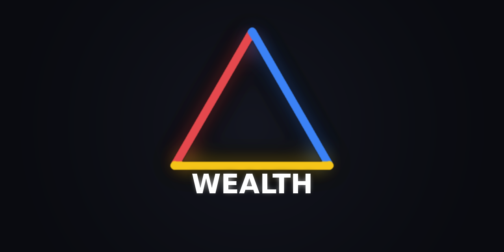

<!-- SOT-MANIFEST
owner: ARIF FAZ (F13 SOVEREIGN)
federation_release: v2026.09.21 (P1 — WEALTH-IDENTITY-PIVOT)
last_verified: 2026-09-21T02:01:00Z
apex_zen: arifOS = ingress + authority · WEALTH = evidence · arifOS = judgment · F13 = decision

surface:
  canonical_primitives: 13        # Ω00 + Ω01-Ω12 (Ω00 = synthesis primitive)
  societal_extensions: 2          # inequality, role scarcity
  infrastructure_tools: 2         # health, registry
  compatibility_aliases: 14       # capital_* legacy names (excluded from canonical)
  total_external_visible: 17      # declared — live tools/list reported 18 on 2026-10-16 (gap row)

authority_ceiling: 555_COMPUTE_ONLY
truth_rule: live :18082/health + tools/list beat any static count in prose

doctrine:
  - WEALTH models capital consequences under uncertainty
  - Analyst (WEALTH) ≠ Judge (arifOS). WEALTH never issues constitutional verdicts.
  - Direct :18082 is engineering/diagnostic. Recommended user path:
    Client → arifOS → WEALTH → arifOS → Human.
  - "Real-time" is misleading; WEALTH reports Live/LatestAvailable with
    source, timestamp, cache_age_seconds, and staleness_class on every
    market/macro output.
-->

<p align="center">
  
</p>

# WEALTH

### Capital consequences before capital movement.

WEALTH is the **capital-evidence organ** of the arifOS federation. It models how capital decisions propagate through liquidity, risk, productivity, time, leverage, macro conditions, incentives, governance and path dependence.

> **If capital moves this way, what follows, and how sure are we?**

WEALTH computes evidence. arifOS judges authority. A-FORGE executes approved actions. Humans remain sovereign.

**Capital consequence infrastructure, not investment advice.**

[Current Verified State](#current-verified-state) · [Ω Architecture](#the-ω-architecture) · [Examples](#what-wealth-helps-examine) · [Data Provenance](#every-market-observation-needs-a-clock) · [Research Roadmap](#research-roadmap-not-current-performance-claims)

[](#governed-use-vs-engineering-use)
[](#advisory-output-never-a-verdict)
[](#every-market-observation-needs-a-clock)
[](https://github.com/ariffazil/WEALTH/actions)
[](./docs/RESEARCH_ROADMAP.md)
[](./LICENSE)

---

## What WEALTH helps examine

- **Capital position** — what assets, liabilities, reserves and obligations exist? (Ω01)
- **Capital movement** — where is liquidity moving, and what changes runway or fragility? (Ω02, Ω07)
- **Capital productivity** — what output is produced per unit of capital and time? (Ω05)
- **Capital environment** — which macro conditions, incentives and constraints shape the outcome? (Ω08, Ω10, Ω11)
- **Capital memory** — how do refinancing, exceptions, governance failures and previous decisions constrain the future? (Ω12)

```text
WEALTH : WorldState → CapitalConsequences        (not WorldState → InvestmentDecision)
```

---

## Capital has memory

Two institutions can show the same balance sheet today and carry different future risk. One may have repeatedly refinanced, normalised exceptions or weakened governance. The other may have preserved reserves, commitments and institutional trust.

```text
Current state ≠ Complete state
Capital reality = Present state + Path dependence
```

WEALTH records not only what exists now, but how the system arrived here (Ω12, `wealth_hysteresis_ledger`).

---

## Governed use vs engineering use

**Governed use.** Connect to arifOS. The kernel delegates bounded capital-analysis work to WEALTH and receives an advisory evidence envelope. This is the recommended path.

**Engineering use.** The direct WEALTH connector (`:18082`) is intended for diagnostics, conformance testing and local development. Direct access does not grant execution authority — it simply bypasses the recommended authority entry path.

```text
World state → WEALTH models capital consequences → arifOS evaluates authority → Human decides
```

---

## Advisory output, never a verdict

```json
{
  "domain_assessment": "CAUTION",
  "execution_authority": "ADVISORY_ONLY",
  "handoff": "arifOS.arif_judge",
  "constitutional_verdicts_issued": []
}
```

WEALTH assessments are domain evidence. They are not `SEAL`, `HOLD`, `SABAR` or `VOID`. Only arifOS issues constitutional verdicts.

## Every market observation needs a clock

A market or macro observation carries: **source · observation timestamp · retrieval timestamp · cache age · staleness classification · known data limitations** (`LIVE | RECENT | STALE | ARCHIVAL`).

**Freshness is not truth — it is evidence about capital consequences. Data is Live and latest-available, never real-time. arifFlow is metabolic telemetry: the metabolic record of the federation.**

---

## Current verified state

**Observed at: 2026-10-16T09:12Z** (live probe `:18082/health`)

| Check | Result |
|---|---|
| Service | **healthy** · runtime seal state `SEALED` · working tree `CLEAN` · commit `5296ff5` |
| Authority ceiling | `COMPUTE_ONLY` — no constitutional verdict capability |
| Canonical primitives observed | 13 (Ω00 + Ω01–Ω12) + 2 societal extensions + 2 infrastructure |
| Live tool count | **18** (`tools/list`) vs **17** declared visible surface — declared-vs-live gap open |
| Freshness metadata coverage | required by contract on market/macro outputs; **coverage not independently measured** |
| arifOS handoff (`wealth_judge_handoff`) | **unmeasured today** (session-gated MUTATE tool) |
| Forecast calibration | **NOT YET PUBLISHED** |
| Historical replay benchmark | **NOT YET PUBLISHED** |

Dynamic state is generated by probe. **If this section conflicts with the live endpoint, the endpoint wins.**

---

## The Ω architecture

**Twelve invariants, one synthesis primitive.** Ω00 (`wealth_synthesize`) is a synthesis roll-up, not a thirteenth domain invariant; Ω01–Ω12 are the twelve capital-consequence invariants (Mass · Flow · Gradient · Entropy · Energy · Time · Inertia · Field · Signal · Game · Boundary · Hysteresis).

The Ω invariants are the fundamentals. NPV, RSI, MACD, Bollinger, PSAR, ATR, ADX, backtest and entry planning are market-microstructure implementations underneath Ω08 (Field) and Ω09 (Signal) — not the identity.

Full Ω00–Ω12 table, capability-surface arithmetic and the L11 AUTH gate: [`docs/OMEGA_ARCHITECTURE.md`](./docs/OMEGA_ARCHITECTURE.md).

### Capability surface

- 13 canonical primitives · 2 societal extensions · 2 infrastructure capabilities
- 14 legacy aliases (`capital_*`) — excluded from the canonical count

**Canonical visible surface: 17** (declared) · live `tools/list` reports 18 (2026-10-16).

---

## Research roadmap (NOT current performance claims)

Two research programmes are **planned, not demonstrated**:

1. **CHRON-linked forecast calibration** — predict → record → verify → recalibrate. No calibration has been published; no predictive superiority is claimed.
2. **Historical-collapse replay** — pre-cutoff evidence only, with a recorded source allowlist, contamination tests and negative controls. The stronger phrase "cryptographic exclusion" is reserved for when a real commitment/hash/signature mechanism exists — it does not yet.

Details and the dated P1 checklist: [`docs/RESEARCH_ROADMAP.md`](./docs/RESEARCH_ROADMAP.md).

---

## Quick start

```bash
git clone https://github.com/ariffazil/WEALTH.git
cd WEALTH
# governed path: connect an MCP client to https://mcp.arif-fazil.com/mcp (arifOS delegates to WEALTH)
# engineering path: run the organ locally, then:
curl -s http://localhost:18082/health | jq '{status, tools_loaded, working_tree}'
```

OBSERVE-class tools pass without a session; MUTATE tools (`capital_ledger`, `wealth_judge_handoff`) require a verified session ([details](./docs/OMEGA_ARCHITECTURE.md#l11-auth-gate-p1-fix)).

## Current limits

- No published forecast calibration, no external benchmark, no demonstrated predictive superiority.
- Declared-vs-live tool-count drift (17 vs 18) open.
- Freshness metadata is contractually mandatory; coverage compliance is not independently measured.
- Single sovereign, single reviewer; no succession procedure published.

## Documentation

[Ω Architecture](./docs/OMEGA_ARCHITECTURE.md) · [Research roadmap](./docs/RESEARCH_ROADMAP.md) · [Boundary](./docs/BOUNDARY.md) · [docs/](./docs/)

## Security · License

[SECURITY.md](./SECURITY.md) · **AGPL-3.0** ([LICENSE](./LICENSE)).

---

> **WEALTH — Capital Consequence Intelligence.**
> It does not decide where money should go.
> It makes the consequences of moving it harder to hide.

**DITEMPA BUKAN DIBERI.**

<!-- FEDERATION-STANDARD v2026-10-15 START :: 333-AGI audit :: source: organs.yaml + git + live probes -->
## 🔗 Federation Identity
| Field | Value |
|---|---|
| Organ | `wealth` · CORE · domain_evidence |
| Ports | 18082 |
| Unit | wealth-organ.service |
| Authority ceiling | COMPUTE_ONLY |
| Public MCP | https://wealth.arif-fazil.com/mcp |
| Flow graph | [FEDERATION.md](https://github.com/ariffazil/AAA/blob/main/FEDERATION.md) — peta semua organ + repo |
<!-- FEDERATION-STANDARD v2026-10-15 END -->

## The 12 Ω-invariants

| Ω | Invariant |
|---|---|
| Ω00 | Cross-dimensional synthesis (wealth_synthesize) |
| Ω01 | conservation |
| Ω02 | flow |
| Ω03 | gradient |
| Ω04 | entropy |
| Ω05 | energy |
| Ω06 | time |
| Ω07 | inertia |
| Ω08 | field |
| Ω09 | signal |
| Ω10 | game |
| Ω11 | boundary |
| Ω12 | hysteresis |

Names are canonical in `wealth_mcp/tools/canonical.py` — counts are live from SOT, not hardcoded prose.
